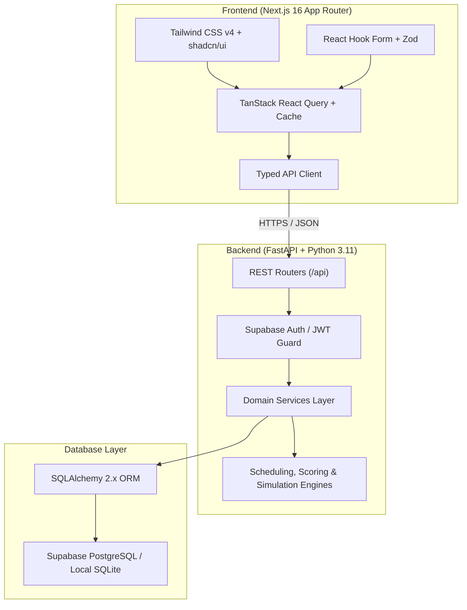

# Adaptive Task & Deadline Management System

[](TEST_EXECUTION_REPORT.md)
[](TEST_EXECUTION_REPORT.md)
[](https://nextjs.org/)
[](https://fastapi.tiangolo.com/)
[](https://www.typescriptlang.org/)
[](https://www.sqlalchemy.org/)

An intelligent, full-stack productivity system engineered for software teams and engineering students. Unlike static to-do lists or rigid Kanban boards, this platform **dynamically adapts daily schedules** based on temporal deadlines, task difficulty, cognitive continuity, user availability windows, and real-time disruptions.

---

## 📑 Table of Contents

- [Architectural Overview](#-architectural-overview)
- [Core Algorithmic Engines](#-core-algorithmic-engines)
- [Novelty Feature: Cascading Disruption Recovery Sandbox](#-novelty-feature-cascading-disruption-recovery-sandbox)
- [Software Engineering Methodology](#-software-engineering-methodology)
- [Technology Stack](#-technology-stack)
- [Repository Layout](#-repository-layout)
- [Getting Started](#-getting-started)
  - [Prerequisites](#prerequisites)
  - [1. Backend Setup (FastAPI)](#1-backend-setup-fastapi)
  - [2. Frontend Setup (Next.js)](#2-frontend-setup-nextjs)
- [REST API Endpoints](#-rest-api-endpoints)
- [Automated Testing & Verification](#-automated-testing--verification)
- [License & Academic Credits](#-license--academic-credits)

---

## 🏛 Architectural Overview

The system is constructed with a decoupled client-server architecture:



---

## ⚙ Core Algorithmic Engines

The backend scheduling subsystem (`backend/app/services/scheduling/`) features five specialized engines:

### 1. Deterministic Prioritization & Scoring Engine (`scoring.py`)
Computes dynamic multi-factor priority scores relative to the current reference timestamp:
$$\text{Score} = W_{\text{priority}} + S_{\text{urgency}}(\Delta t) + S_{\text{difficulty}} + B_{\text{continuity}} + S_{\text{feasibility}}$$
- **Priority Weights:** Critical (400 pts), High (300 pts), Medium (200 pts), Low (100 pts).
- **Temporal Urgency Decay:** Overdue tasks receive maximal urgency ($600 + \text{overdue hours} \times 2$); tasks due within 24 hours scale monotonically.
- **Cognitive Continuity Bonus:** Grants $+60\text{ pts}$ to active `in_progress` tasks to prevent thrashing and minimize mental context-switching costs.
- **Workload Pressure Ratio:** Boosts tasks whose remaining effort approaches their available deadline window.
- **Deterministic 4-Tier Tie-Breaking:** $\text{Score} \downarrow \to \text{Deadline} \uparrow \to \text{Remaining Work} \downarrow \to \text{ID} \uparrow$.

### 2. Capacity & Fatigue Engine (`capacity.py`)
- Evaluates daily working windows from weekly availability schedules (`09:00` to `17:00`).
- Clamps gross allocatable time to user `daily_focus_hours_limit` to prevent cognitive burnout.
- Deducts configurable buffer strategies:
  - **Tight:** $0\%$ buffer (dense allocation)
  - **Moderate:** $10\%$ buffer (standard spacing)
  - **Relaxed:** $20\%$ buffer (comfortable recovery gaps)

### 3. Adaptive Scheduling Engine (`engine.py`)
- Generates conflict-free daily focus blocks for any requested calendar date.
- Enforces strict deadline boundaries: **no task is ever scheduled after its deadline has passed**.
- Detects schedule regeneration triggers when tasks slip, complete early, or become overdue.

### 4. Deadline Risk & Compression Analyzer (`risk.py`)
- Classifies active tasks into risk tiers (`critical`, `high`, `moderate`).
- Flags tasks where remaining duration strictly exceeds total allocatable capacity before the deadline.

---

## 🌟 Novelty Feature: Cascading Disruption Recovery Sandbox

> **Module:** `backend/app/services/scheduling/simulation.py`  
> **UI Component:** `frontend/components/schedule/disruption-simulator-dialog.tsx`

Traditional task managers collapse when a user experiences an unexpected delay (such as an emergency meeting or a task taking 3 hours longer than estimated). 

The **What-If Disruption Simulator** solves this with an isolated mathematical sandbox:

1. **Zero-Side-Effect Sandbox:** Models cascading delays across a **7-day planning horizon** without altering live database records.
2. **Cascading Breach Detection:** Quantifies downstream deadline breaches caused by the delay offset.
3. **Automated Synthesis of 3 Recovery Strategies:**
   - **Strategy 1: Elastic Buffer Compression (`buffer_absorption`)**  
     Compresses safety buffer margins (e.g. from moderate $10\%$ down to $0\%$) to absorb lost hours with **zero deadline changes**.
   - **Strategy 2: Priority-Preserving Triage (`workload_triage`)**  
     Strictly shields `critical` deliverables while postponing secondary/low-priority tasks by 3 days.
   - **Strategy 3: Surgical Deadline Extension (`deadline_extension`)**  
     Calculates the exact minimal deadline renegotiation for the bottleneck task to restore $100\%$ feasibility.
4. **1-Click Atomic Execution:** Users compare feasibility scores, stress indices, and trade-offs, committing the chosen strategy to the database in one click.

---

## 📐 Software Engineering Methodology

The project followed an **Iterative and Incremental Agile Lifecycle** structured into four major delivery phases:

| Phase | Milestone | Deliverables |
| :---: | :--- | :--- |
| **Phase 1** | **Design System & Shell** | Next.js App Router, Tailwind v4 design tokens, shadcn/ui components, responsive `AppShell` with mobile drawer navigation. |
| **Phase 2** | **Authentication & Domain** | Supabase Auth, asymmetric JWT verification (JWKS / HMAC), SQLAlchemy 2.x declarative models, and database constraints. |
| **Phase 3** | **Core Subsystems** | **Phase 3A:** Task CRUD, validation, search, filtering, and view toggling.<br>**Phase 3B:** Adaptive capacity, scoring, and conflict-free timeline engines.<br>**Phase 3C:** Real-time dashboard analytics and Recommended Next Task card. |
| **Phase 4** | **Integration & Novelty** | Live FastAPI backend cutover, Pytest automated testing suite, Selenium headless E2E verification, and Cascading Disruption Recovery Sandbox. |

---

## 💻 Technology Stack

### Frontend
- **Framework:** Next.js 16.4.3 (App Router, Turbopack)
- **Language:** TypeScript 5.x
- **Styling:** Tailwind CSS v4 & Lucide React icons
- **Component Primitives:** shadcn/ui & `@base-ui/react`
- **State & Data Fetching:** TanStack Query v5 (`@tanstack/react-query`)
- **Forms & Validation:** React Hook Form & Zod
- **Notifications:** Sonner Toast Engine

### Backend
- **Framework:** FastAPI 0.115+ (Python 3.11)
- **Server:** Uvicorn (ASGI)
- **ORM & Database Toolkit:** SQLAlchemy 2.x & Alembic
- **Validation & Serialization:** Pydantic v2 (camelCase alias generator)
- **Authentication:** Supabase Auth & Python-Jose JWT verification
- **Database:** Supabase PostgreSQL (Production) / Local SQLite (Deterministic Testing)

### Testing & Quality Assurance
- **Unit Testing:** Pytest 8.4.2 (27 test cases covering capacity, scoring, risk, lifecycle, and simulation)
- **E2E Testing:** Selenium WebDriver with Headless Google Chrome (16 test cases)
- **Reporter:** Automated `TEST_EXECUTION_REPORT.md` generation

---

## 📁 Repository Layout

```
.
├── backend/
│   ├── app/
│   │   ├── api/routes/          # REST endpoints (tasks, schedule, dashboard, settings, health)
│   │   ├── core/                # Auth verification, JWT security, Pydantic settings
│   │   ├── db/                  # Engine factory, session maker, SQLAlchemy Base
│   │   ├── models/              # Profile, Task, UserAvailability, UserPreferences
│   │   ├── schemas/             # Pydantic request/response DTOs
│   │   └── services/            # Domain services & scheduling algorithms
│   │       └── scheduling/      # scoring.py, capacity.py, engine.py, risk.py, simulation.py
│   ├── .env.example             # Backend configuration template
│   └── requirements.txt         # Python dependencies
├── frontend/
│   ├── app/                     # App Router (/dashboard, /tasks, /schedule, /settings, /login)
│   ├── components/              # UI components (tasks, schedule, dashboard, common, ui)
│   ├── hooks/                   # React Query hooks (useTasks, useSchedule, useDashboard, etc.)
│   ├── services/api/            # Typed REST API clients
│   └── types/                   # TypeScript domain contracts
├── tests/
│   ├── conftest.py              # Pytest fixtures and automated markdown execution reporter
│   ├── unit/                    # Unit tests for scoring, capacity, risk, and simulation
│   └── e2e_selenium/            # End-to-end headless Chrome Selenium test scenarios
├── TEST_EXECUTION_REPORT.md     # Formal test execution results matrix
└── README.md                    # Project documentation
```

---

## 🚀 Getting Started

### Prerequisites
- **Python:** 3.11+
- **Node.js:** 18.18+ (tested on Node.js 22.x/24.x)
- **Package Manager:** npm or yarn

---

### 1. Backend Setup (FastAPI)

1. Navigate to the `backend` directory:
   ```bash
   cd backend
   ```

2. Create and activate a Python virtual environment:
   ```bash
   # Windows PowerShell
   python -m venv .venv
   .\.venv\Scripts\Activate.ps1

   # Linux / macOS
   python3 -m venv .venv
   source .venv/bin/activate
   ```

3. Install required packages:
   ```bash
   pip install -r requirements.txt
   ```

4. Configure environment variables:
   ```bash
   cp .env.example .env
   ```
   *(By default, `DATABASE_URL=sqlite:///./adaptive_tasks.db` allows immediate local execution without external cloud dependencies).*

5. Start the FastAPI development server:
   ```bash
   uvicorn app.main:app --host 127.0.0.1 --port 8000 --reload
   ```
   Interactive Swagger documentation will be available at: **[http://127.0.0.1:8000/docs](http://127.0.0.1:8000/docs)**.

---

### 2. Frontend Setup (Next.js)

1. Open a new terminal and navigate to the `frontend` directory:
   ```bash
   cd frontend
   ```

2. Install dependencies:
   ```bash
   npm install
   ```

3. Configure environment variables:
   ```bash
   cp .env.example .env.local
   ```
   Ensure `.env.local` points to your running backend:
   ```env
   NEXT_PUBLIC_API_URL=http://localhost:8000/api
   ```

4. Start the Next.js development server:
   ```bash
   npm run dev
   ```
   Access the web application at: **[http://localhost:3000](http://localhost:3000)**.

---

## 🔌 REST API Endpoints

| Method | Endpoint | Description |
| :--- | :--- | :--- |
| `GET` | `/api/health` | Service health status and database connectivity check |
| `GET` | `/api/tasks` | Retrieve user tasks with category, status, priority filters, and sorting |
| `POST` | `/api/tasks` | Create a new task with validation (duration, difficulty, priority) |
| `PUT` | `/api/tasks/{id}` | Update task progress, completed duration, or status |
| `DELETE` | `/api/tasks/{id}` | Permanently remove a task entity |
| `GET` | `/api/dashboard/overview` | Summary metrics: available capacity, workload, progress %, at-risk count |
| `GET` | `/api/schedule` | Retrieve dynamically allocated daily timeline blocks for a target date |
| `POST` | `/api/schedule/regenerate` | Recalculate timeline blocks dynamically |
| `POST` | `/api/schedule/simulate` | **Sandbox:** Run what-if disruption cascade & synthesize 3 recovery strategies |
| `POST` | `/api/schedule/simulate/apply` | Commit an approved recovery strategy to the persistent schedule |
| `GET` | `/api/settings` | Retrieve user weekly availability windows and focus preferences |
| `PUT` | `/api/settings/availability` | Update working hours for weekdays (Monday–Sunday) |
| `PUT` | `/api/settings/preferences` | Update daily focus hours limit and buffer margin strategy |

---

## 🧪 Automated Testing & Verification

The project includes an automated test harness ensuring regressions are prevented across every engine and user interaction:

```bash
# Run all unit tests with virtual environment Python
backend\.venv\Scripts\python.exe -m pytest tests/unit -v

# Run Selenium End-to-End Headless Chrome UI tests (servers must be running)
backend\.venv\Scripts\python.exe -m pytest tests/e2e_selenium -v
```

### Formal Test Execution Summary
Execution results are recorded in **[`TEST_EXECUTION_REPORT.md`](TEST_EXECUTION_REPORT.md)**:
- **Total Tests:** 27 Unit Tests + 16 Selenium E2E Tests
- **Status:** **100% Passed (0 Failed)**
- **Coverage Areas:**
  - `TC_UNIT_ENG_*`: Focus limit caps, disabled weekdays, sequential non-overlapping blocks, deadline truncation.
  - `TC_UNIT_SCORE_*`: Priority hierarchy, exponential urgency scaling, continuity bonus, workload pressure ratio.
  - `TC_UNIT_SIM_*`: Resilient schedule absorption, cascading breach detection, triage deliverable protection, recovery strategy commit.
  - `TC_UNIT_VAL_*`: Boundary title validation, duration bounds (0 < h $\le$ 500), auto-completion rules.
  - `TC_SEL_*`: DOM rendering, priority badges, responsive sorting, context actions, modal validation, view switching.

---

## 📜 License & Academic Credits

- **Course:** Year 2 Software Engineering Microproject
- **Repository:** [`Juvansan-codes/SE-Adaptive-Task-and-Deadline-Management`](https://github.com/Juvansan-codes/SE-Adaptive-Task-and-Deadline-Management)
- Developed adhering to Software Engineering principles of modular cohesion, loose coupling, deterministic heuristic optimization, and automated regression testing.
